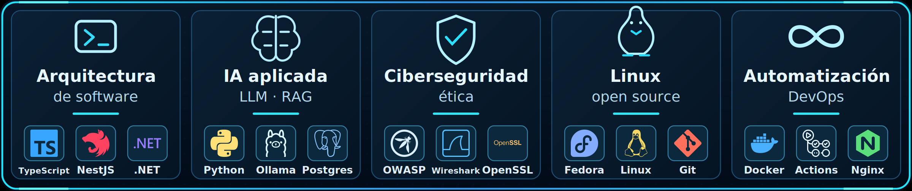
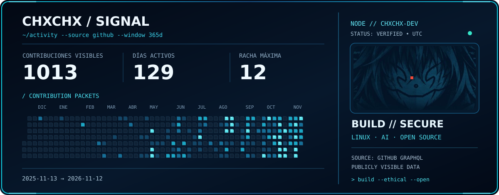

<picture>
  <source media="(prefers-reduced-motion: reduce)" srcset="./assets/header-original.png" />
  
</picture>

  <strong>Linux · Open Source · Secure by Design</strong>

  <em>Building scalable software, applied AI/LLM systems, secure automation, and open-source tools on Linux.</em>

  Build deliberately · Secure ethically · Open by default

  
    <a href="./docs/ROADMAP.md">Roadmap</a> ·
    <a href="https://github.com/chxchx-dev">GitHub</a>
  

