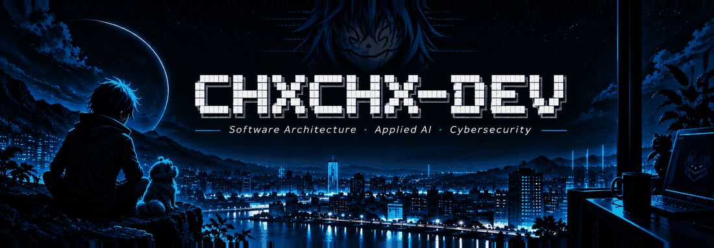
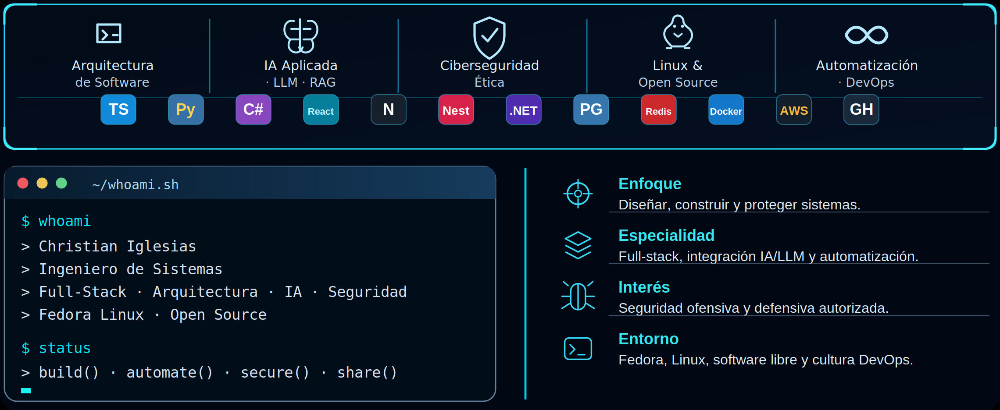
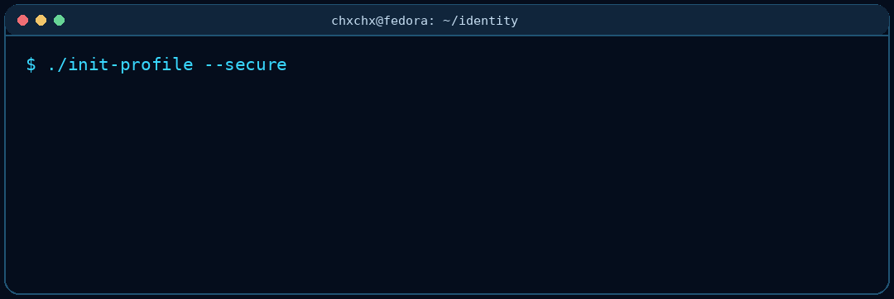
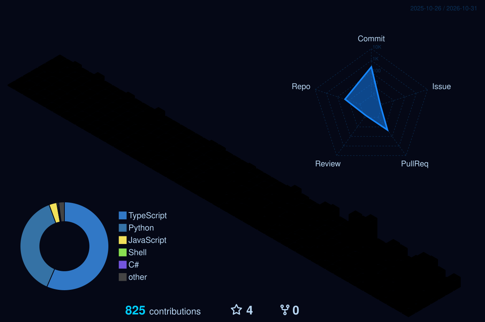

<picture>
  <source media="(prefers-reduced-motion: reduce)" srcset="./assets/header-original.png" />
  
</picture>

**Linux · Open Source · Secure by Design**

 

## `~/activity`

Build deliberately · Secure ethically · Open by default

[Roadmap del perfil](./docs/ROADMAP.md) · [GitHub](https://github.com/chxchx-dev)

