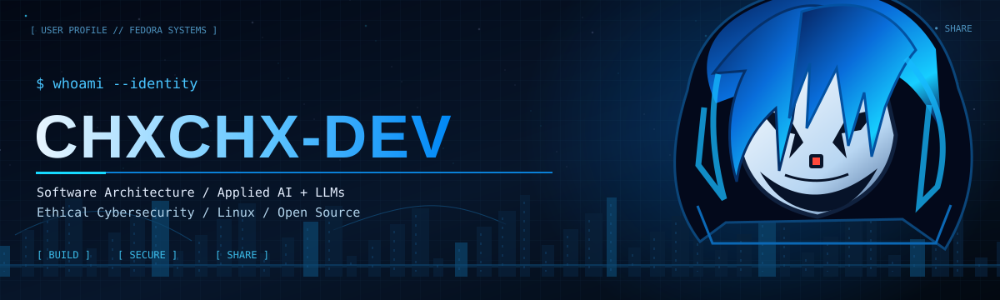
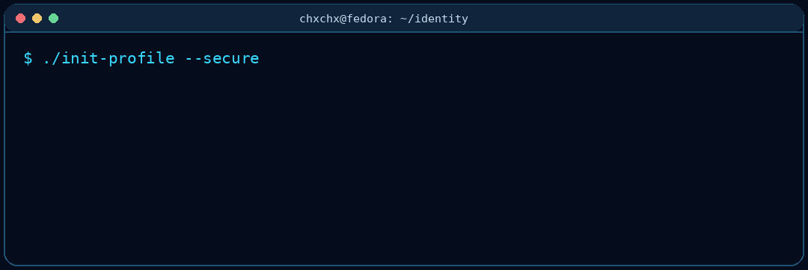
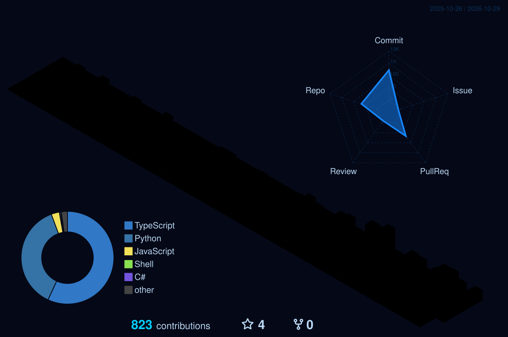

<div align="center">



<br />

**Software Architecture · Applied AI & LLM Systems · Ethical Cybersecurity**

`Linux` · `Open Source` · `Automation` · `Secure by Design`

[](https://github.com/chxchx-dev)
[](https://github.com/chxchx-dev?tab=repositories)

</div>

## `~/identity`

```console
chxchx@fedora:~$ whoami
Christian Iglesias | Systems Engineer & Full-Stack Developer

chxchx@fedora:~$ cat /etc/focus
01 / Software architecture      → maintainable, scalable systems
02 / Applied AI & LLMs           → RAG, AI gateways, local inference
03 / Ethical cybersecurity       → privacy, authentication, secure tooling
04 / Linux & open source         → practical tools, transparency, autonomy
05 / DevOps & automation         → reliable delivery and observability
```

<div align="center">

</div>

## `~/build --proof`

Proyectos públicos seleccionados por su **implementación y documentación**, no por una lista de tecnologías.

| Proyecto | Qué construye | Enfoque |
|:--|:--|:--|
| [**ACoreAI Gateway**](https://github.com/chxchx-dev/acoreai-gateway) | Gateway para asistentes con RAG, fuentes aprobadas, roles, auditoría y modelos locales | AI / Architecture |
| [**ChxChx Security**](https://github.com/chxchx-dev/chxchx-security-ip) | Utilidades de privacidad en terminal para Fedora, Ubuntu y Kali; límites de protección documentados | Security / Linux |
| [**OAuth2 + PKCE**](https://github.com/chxchx-dev/OAuth2-PKCE) | Núcleo reusable para Authorization Code + PKCE, rotación y revocación de tokens | Identity / Security |
| [**DeviceBridge Linux**](https://github.com/chxchx-dev/device-bridge-linux) | Control plane local entre Fedora y Android con comandos permitidos y arquitectura auditable | Linux / Architecture |
| [**JobScout**](https://github.com/chxchx-dev/JobScout) | Extensión MV3 para organizar vacantes y seguimiento manual, con fuentes autorizadas | Open Source / Automation |

> Otros proyectos como DentyKit y ACore CRM permanecen fuera de esta tabla mientras sus repositorios sean privados. No publico enlaces a código que no es accesible.

## `~/toolchain`

**Lenguajes:** TypeScript · JavaScript · Python · C# · SQL

**Arquitectura & backend:** NestJS · .NET · Node.js · REST · SSE · JWT / OAuth2

**Frontend & datos:** React · Next.js · PostgreSQL · Redis · pgvector

**Infraestructura & sistemas:** Fedora Linux · Docker · GitHub Actions · AWS · Nginx

**IA aplicada:** Ollama · LLMs locales · RAG · Embeddings · Automatización

## `~/principles`

```text
build()     > herramientas útiles y verificables
secure()    > seguridad y privacidad desde el diseño
document()  > decisiones, límites, pruebas y evidencias
share()     > preferencia por software libre y conocimiento abierto
improve()   > aprender, aplicar, medir, repetir
```

## `~/activity`

<div align="center">



</div>

## `~/next`

Este perfil es un proyecto vivo. La terminal GIF y el calendario 3D se actualizan mediante GitHub Actions. Ver [roadmap](./docs/ROADMAP.md) para próximos laboratorios, accesibilidad y evidencia de proyectos.

<div align="center">

**Build deliberately. Secure ethically. Keep learning in public.**

<sub>© CHXCHX-DEV · Hecho con Markdown, SVG, Python y tecnologías abiertas.</sub>

</div>
